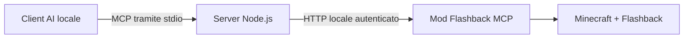

<div align="center">

# Flashback MCP

### I tuoi replay di Minecraft. Il tuo assistente AI. Un unico flusso creativo.

Controlla i replay, componi inquadrature, modifica i keyframe ed esporta video dal tuo client AI locale compatibile con MCP.

[](https://github.com/Jepez00/FlashbackMCP/releases/tag/v1.0.0)
[](https://nodejs.org/)
[](LICENSE)
[](https://modrinth.com/mod/flashbackmcp)

[English](README.md) · **Italiano**

[Scarica il server](https://github.com/Jepez00/FlashbackMCP/releases/latest/download/flashback-mcp-server.mjs) · [Scarica la mod](https://modrinth.com/mod/flashbackmcp) · [Installazione](#installazione) · [Segnala un problema](https://github.com/Jepez00/FlashbackMCP/issues)

</div>

Flashback MCP collega un assistente AI a [Flashback](https://modrinth.com/mod/flashback), l'editor di replay di Minecraft. Descrivi l'inquadratura che vuoi ottenere, controlla la timeline insieme all'assistente, visualizza le anteprime e trasforma un replay in un video grazie a **22 strumenti** accessibili tramite il Model Context Protocol.

Questo repository contiene il **server MCP in Node.js**. Per collegarlo al gioco devi installare anche la [mod Fabric Flashback MCP](https://modrinth.com/mod/flashbackmcp). Il server **non ha dipendenze npm** e non richiede una propria chiave API: account e modello vengono gestiti dal client AI che utilizzi.

## Cosa puoi fare

| Area | Funzioni |
| --- | --- |
| Replay | Elencare, aprire e chiudere registrazioni; riprodurre, mettere in pausa, saltare a un punto e cambiare velocità. |
| Camera | Posizionare la camera, regolare rotazione e FOV e individuare le entità vicine. |
| Timeline | Leggere scene e tracce; creare, rinominare o eliminare tracce; modificare keyframe e annullare/ripristinare modifiche. |
| Effetti cinematografici | Animare percorsi e orbite della camera, FOV, velocità, ora del giorno, blocchi dell'azione e vibrazioni della camera. |
| Aspetto della scena | Modificare HUD, opzioni di rendering, meteo e altre impostazioni visive di Flashback. |
| Anteprime ed esportazione | Restituire screenshot PNG all'assistente, impostare l'intervallo di esportazione, creare video e seguirne l'avanzamento. |
| Registrazione | Avviare, sospendere, riprendere, terminare o annullare una registrazione durante il gioco. |

Esempi di richieste dopo aver collegato il server:

> «Mostrami i replay disponibili e apri quello più recente.»
>
> «Crea un movimento fluido della camera tra queste due posizioni e mostrami il primo e l'ultimo fotogramma.»
>
> «Nascondi l'HUD, imposta l'intervallo di esportazione sul percorso della camera ed esporta la scena in un video.»

L'assistente richiama gli strumenti; Minecraft e Flashback eseguono le modifiche e il rendering. La disponibilità degli strumenti e delle immagini dipende dal client e dal modello utilizzati.

## Requisiti

| Componente | Versione / requisito |
| --- | --- |
| Minecraft | Qualsiasi versione per cui esiste Flashback: vedi [Versioni supportate](#versioni-supportate) |
| Java | **21+** per Minecraft 1.21.x, **25+** per Minecraft 26.x |
| Fabric Loader | **0.15.10+** per Minecraft 1.21.x, **0.19.0+** per Minecraft 26.x |
| Flashback | La versione indicata qui sotto per il tuo Minecraft; installa le dipendenze richieste, inclusa Fabric API |
| Mod Flashback MCP | **1.0.0**, il JAR per la tua versione di Minecraft, da [Modrinth](https://modrinth.com/mod/flashbackmcp) |
| Node.js | **18+**; usa una versione ancora supportata da [nodejs.org](https://nodejs.org/) |
| Client AI | Un client locale capace di avviare un server MCP tramite **stdio** |

Minecraft e il processo MCP devono essere eseguiti sullo **stesso computer e con lo stesso utente del sistema operativo**. WSL, container ed esecutori remoti non condividono automaticamente la cartella utente e la connessione del gioco avviato su Windows.

### Versioni supportate

Ogni versione di Minecraft ha il suo JAR della mod. Il server è lo stesso per tutte.

| Minecraft | JAR della mod | Flashback | Java |
| --- | --- | --- | --- |
| 1.21 – 1.21.1 | `flashback-mcp-1.0.0+mc1.21.1.jar` | 0.39.10 o successiva | 21 |
| 1.21.4 | `flashback-mcp-1.0.0+mc1.21.4.jar` | 0.39.10 o successiva | 21 |
| 1.21.5 | `flashback-mcp-1.0.0+mc1.21.5.jar` | 0.39.10 o successiva | 21 |
| 1.21.6 – 1.21.8 | `flashback-mcp-1.0.0+mc1.21.8.jar` | 0.39.10 o successiva | 21 |
| 1.21.9 – 1.21.10 | `flashback-mcp-1.0.0+mc1.21.10.jar` | 0.39.10 o successiva | 21 |
| 1.21.11 | `flashback-mcp-1.0.0+mc1.21.11.jar` | 0.39.10 o successiva | 21 |
| 26.1 – 26.1.2 | `flashback-mcp-1.0.0+mc26.1.2.jar` | 0.43.3 o successiva | 25 |
| 26.2 | `flashback-mcp-1.0.0+mc26.2.jar` | 0.43.3 o successiva | 25 |
| 26.3 | `flashback-mcp-1.0.0+mc26.3.jar` | 0.43.4 o successiva | 25 |

I 22 strumenti sono gli stessi su ogni versione. Flashback 0.39 (Minecraft 1.21.x) non ha le proiezioni ORTHOGRAPHIC, CUBE_MAP ed EQUIRECTANGULAR, le sequenze EXR e le mappe di profondità: se le chiedi, ricevi un errore chiaro.

## Installazione

### 1. Installa la mod in Minecraft

1. Apri la cartella `mods` del profilo Minecraft che utilizzi davvero.
2. Installa Fabric, Flashback e le dipendenze indicate nelle rispettive pagine di download per la tua versione di Minecraft.
3. Scarica **Flashback MCP 1.0.0** per la tua versione di Minecraft da [Modrinth](https://modrinth.com/mod/flashbackmcp) e inserisci il JAR indicato nella [tabella qui sopra](#versioni-supportate) nella cartella `mods` del profilo. Sostituisci eventuali vecchi JAR di Flashback MCP per evitare duplicati.

Il file `.jar` va nella cartella `mods` di Minecraft. Il server `.mjs` descritto di seguito va in una cartella separata e permanente del computer.

### 2. Scarica il server MCP

Installa [Node.js](https://nodejs.org/) e verifica da un terminale:

```sh
node --version
```

Scarica **[flashback-mcp-server.mjs](https://github.com/Jepez00/FlashbackMCP/releases/latest/download/flashback-mcp-server.mjs)** e salvalo in una cartella permanente, per esempio `C:\Tools\FlashbackMCP\` su Windows oppure `~/Tools/FlashbackMCP/` su macOS/Linux. Nella [pagina della release](https://github.com/Jepez00/FlashbackMCP/releases/latest) trovi anche lo ZIP con entrambe le guide e i checksum SHA-256.

Il file autonomo include il catalogo degli strumenti: **per usarlo non servono `npm install`, Python o compilazione**. Mantieni l'estensione `.mjs` quando salvi il file.

### 3. Genera la configurazione per il tuo client

Su Windows PowerShell, sostituisci il percorso d'esempio con quello del file che hai salvato:

```powershell
node "C:\Tools\FlashbackMCP\flashback-mcp-server.mjs" --print-config codex
```

Su macOS/Linux:

```sh
node "$HOME/Tools/FlashbackMCP/flashback-mcp-server.mjs" --print-config codex
```

Sostituisci `codex` con il valore del tuo client nella tabella. Il comando stampa la configurazione con i **percorsi assoluti reali** di Node.js e del server, senza modificare le impostazioni. Aggiungi la voce `flashback` al file indicato, conservando le impostazioni e gli altri server MCP già presenti.

| Client | Valore | Dove inserire la configurazione generata |
| --- | --- | --- |
| Codex CLI / app / IDE | `codex` | `~/.codex/config.toml` — TOML |
| Claude Code | `claude` | File `.mcp.json` del progetto, oppure comando CLI qui sotto |
| Claude Desktop | `claude` | `claude_desktop_config.json`, accessibile da Settings → Developer |
| Cursor | `cursor` | `~/.cursor/mcp.json` oppure `.cursor/mcp.json` del progetto |
| Gemini CLI | `gemini` | `~/.gemini/settings.json` |
| VS Code / GitHub Copilot | `vscode` | `.vscode/mcp.json` del progetto oppure **MCP: Open User Configuration** |
| Altri client MCP locali | `generic` | Adatta il JSON `mcpServers` al formato del client |

`~` indica la cartella del tuo utente, per esempio `C:\Users\TuoNome` su Windows. Nei file JSON aggiungi la voce dentro l'oggetto `mcpServers` o `servers` esistente, senza duplicarlo. Nel TOML deve esserci una sola sezione `[mcp_servers.flashback]`.

**Non inserire `--print-config` negli argomenti di avvio salvati.** Il client AI deve eseguire soltanto Node.js con il percorso completo del file `.mjs`. Sarà il client ad avviare e arrestare il server.

#### Scorciatoie da terminale

Se preferisci registrare il server tramite CLI, usa il tuo percorso assoluto reale:

```sh
codex mcp add flashback -- node "/percorso/assoluto/flashback-mcp-server.mjs"
codex mcp get flashback
```

```sh
claude mcp add --transport stdio --scope user flashback -- node "/percorso/assoluto/flashback-mcp-server.mjs"
```

Per Codex, il TOML generato imposta anche `tool_timeout_sec = 1200`: aggiungilo alla voce registrata per caricamenti di replay ed esportazioni lunghe. La configurazione Gemini imposta lo stesso limite di 20 minuti in millisecondi. Se PowerShell blocca il launcher `.ps1` di una CLI npm, usa quello `.cmd`, per esempio `codex.cmd`.

### 4. Attiva il collegamento e verifica la connessione

1. Avvia il profilo Minecraft con Flashback e Flashback MCP.
2. Dal menu principale o dal menu di pausa seleziona **MCP → Attiva server MCP** (*Enable MCP server* se il gioco è in inglese).
3. Riavvia o riconnetti il client AI e abilita/autorizza il server quando richiesto dal client.
4. Chiedi: **«Chiama `flashback_status` e dimmi se Minecraft è collegato.»**

Se la chiamata riesce, ricevi lo stato del gioco, per esempio `menu`, `in_world`, `replay` o `exporting`. Apri un replay prima di utilizzare gli strumenti per timeline e camera. Per screenshot ed esportazione video passa alla **modalità finestra con F11**.

## Come funziona il collegamento



La mod scrive i dati della connessione in `~/.flashback-mcp/bridge.json`. Il server li rileva automaticamente e si collega a `127.0.0.1`: non devi configurare porte o incollare token. Mantieni privato quel file. Per configurazioni avanzate, `FLASHBACK_MCP_BRIDGE_FILE` permette di scegliere un altro file di connessione locale.

Questa release fornisce un **server stdio locale**, non un endpoint MCP HTTP pubblico. Client solo browser/cloud e client che accettano soltanto MCP HTTP richiedono un'integrazione locale compatibile separata. Richieste e screenshot vengono passati al client AI scelto, del quale si applicano modello e politiche sui dati.

## Risoluzione dei problemi

| Problema | Cosa controllare |
| --- | --- |
| `node` non viene riconosciuto | Installa Node.js e riapri terminale/client. Il generatore di configurazione usa il percorso assoluto dell'eseguibile. |
| Il server non compare o si chiude subito | Controlla percorso ed estensione `.mjs`. Rimuovi `--print-config` dagli argomenti di avvio. Se usi i sorgenti, lascia `tools.json` accanto a `server.mjs`. |
| Minecraft risulta spento o MCP disattivato | Avvia il profilo corretto, abilita MCP nel gioco e usa lo stesso utente del sistema operativo per il client. |
| Token rifiutato dopo il riavvio di Minecraft | Ripeti la chiamata: il server legge i dati aggiornati della connessione a ogni richiesta. |
| Un messaggio chiede di rimuovere le impostazioni remote | Rimuovi `FLASHBACK_MCP_URL` e `FLASHBACK_MCP_TOKEN`: il collegamento viene rilevato automaticamente. |
| Screenshot o esportazione falliscono a schermo intero | Premi **F11** per passare alla modalità finestra. |
| Un'operazione lunga va in timeout | Aumenta il timeout del client, se disponibile. Per esportare usa `wait: false` e controlla `flashback_status` fino alla fine del rendering. |
| Eseguendo `node server.mjs` non succede nulla | Senza argomenti il server attende messaggi MCP su stdin. È normale: solitamente lo avvia il client AI. |

Per segnalare un problema indica versioni di gioco/mod/Node, nome del client e messaggio d'errore. Non includere il contenuto di `bridge.json` o credenziali private del client.

## Sorgenti

```text
flashback-mcp-server.mjs  Server autonomo pronto all'uso
mcp-server/server.mjs    Sorgente del server
mcp-server/tools.json    Catalogo completo e schemi dei 22 strumenti
scripts/                 Script per generare il file autonomo
README.md                English guide
README.it.md             Guida in italiano
```

Per lavorare sui sorgenti:

```sh
git clone https://github.com/Jepez00/FlashbackMCP.git
cd FlashbackMCP
npm run build
```

Non occorre installare dipendenze. Il punto di avvio dei sorgenti è `mcp-server/server.mjs`, con `tools.json` accanto; accetta le stesse opzioni `--print-config` del file autonomo.

Revisioni MCP supportate: `2024-11-05`, `2025-03-26`, `2025-06-18`, `2025-11-25`. I client più recenti devono negoziare una revisione supportata.

## Crediti e documentazione

Creato da **Jepez**. Codice del server e documentazione: tutti i diritti riservati (vedi [LICENSE](LICENSE)). Flashback è creato da **Moulberry**; Minecraft appartiene a **Mojang / Microsoft**. Questo è un progetto indipendente. Consulta le [attribuzioni](THIRD_PARTY_NOTICES.md).

Riferimenti per configurare i client: [Codex](https://developers.openai.com/codex/mcp), [Claude Code](https://code.claude.com/docs/en/mcp), [Cursor](https://cursor.com/docs/mcp), [Gemini CLI](https://geminicli.com/docs/tools/mcp-server/), [VS Code](https://code.visualstudio.com/docs/agents/reference/mcp-configuration).
