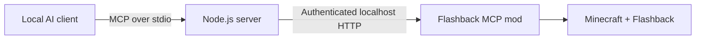

<div align="center">

# Flashback MCP

### Your Minecraft replays. Your AI assistant. One creative workflow.

Control replay playback, compose camera shots, edit keyframes and export videos from your favorite local MCP-compatible AI client.

[](https://github.com/Jepez00/FlashbackMCP/releases/tag/v1.0.0)
[](https://nodejs.org/)
[](LICENSE)
[](https://modrinth.com/mod/flashbackmcp)

**English** · [Italiano](README.it.md)

[Download the server](https://github.com/Jepez00/FlashbackMCP/releases/latest/download/flashback-mcp-server.mjs) · [Get the mod](https://modrinth.com/mod/flashbackmcp) · [Installation](#installation) · [Report an issue](https://github.com/Jepez00/FlashbackMCP/issues)

</div>

Flashback MCP connects an AI assistant to [Flashback](https://modrinth.com/mod/flashback), the Minecraft replay editor. Describe the shot you want, inspect the timeline together, preview frames and turn a replay into a finished video using **22 tools** exposed through the Model Context Protocol.

This repository contains the **Node.js MCP server**. Install the companion [Flashback MCP Fabric mod](https://modrinth.com/mod/flashbackmcp) in Minecraft to connect it to the game. The server has **no npm dependencies** and needs no provider API key of its own; your AI client manages its model and account.

## What you can do

| Area | Features |
| --- | --- |
| Replays | List, open and close recordings; play, pause, seek and change playback speed. |
| Camera | Position the camera, adjust its rotation and FOV, and locate nearby entities. |
| Timeline | Read scenes and tracks; create, rename or remove tracks; edit keyframes and undo/redo changes. |
| Cinematic effects | Animate camera paths, orbits, FOV, speed, time of day, freezes and camera shake. |
| Visuals | Adjust HUD visibility, rendering options, weather and other Flashback visual settings. |
| Preview & export | Return PNG screenshots to the assistant, set export ranges, render videos and monitor progress. |
| Recording | Start, pause, resume, finish or cancel a recording while playing. |

Examples to ask your assistant after connecting:

> “Show my available replays and open the newest one.”
>
> “Create a smooth camera move between these two positions and preview the first and last frames.”
>
> “Hide the HUD, set the export range to the camera path and export the scene as a video.”

The assistant uses the tools; Minecraft and Flashback perform the editing and rendering. Tool and image availability depends on the client and model you use.

## Requirements

| Component | Version / requirement |
| --- | --- |
| Minecraft | Any version Flashback is published for: see [Supported versions](#supported-versions) |
| Java | **21+** for Minecraft 1.21.x, **25+** for Minecraft 26.x |
| Fabric Loader | **0.15.10+** for Minecraft 1.21.x, **0.19.0+** for Minecraft 26.x |
| Flashback | The version listed for your Minecraft below; install its required dependencies, including Fabric API |
| Flashback MCP mod | **1.0.0**, the JAR for your Minecraft version, from [Modrinth](https://modrinth.com/mod/flashbackmcp) |
| Node.js | **18+**; use a maintained release from [nodejs.org](https://nodejs.org/) |
| AI client | A local client that can launch an MCP server over **stdio** |

Run Minecraft and the MCP process on the **same computer, under the same operating-system user**. WSL, containers and remote executors do not automatically share the Windows game's home directory and connection.

### Supported versions

Each Minecraft version has its own mod JAR. The server is the same for all of them.

| Minecraft | Mod JAR | Flashback | Java |
| --- | --- | --- | --- |
| 1.21 – 1.21.1 | `flashback-mcp-1.0.0+mc1.21.1.jar` | 0.39.10 or newer | 21 |
| 1.21.4 | `flashback-mcp-1.0.0+mc1.21.4.jar` | 0.39.10 or newer | 21 |
| 1.21.5 | `flashback-mcp-1.0.0+mc1.21.5.jar` | 0.39.10 or newer | 21 |
| 1.21.6 – 1.21.8 | `flashback-mcp-1.0.0+mc1.21.8.jar` | 0.39.10 or newer | 21 |
| 1.21.9 – 1.21.10 | `flashback-mcp-1.0.0+mc1.21.10.jar` | 0.39.10 or newer | 21 |
| 1.21.11 | `flashback-mcp-1.0.0+mc1.21.11.jar` | 0.39.10 or newer | 21 |
| 26.1 – 26.1.2 | `flashback-mcp-1.0.0+mc26.1.2.jar` | 0.43.3 or newer | 25 |
| 26.2 | `flashback-mcp-1.0.0+mc26.2.jar` | 0.43.3 or newer | 25 |
| 26.3 | `flashback-mcp-1.0.0+mc26.3.jar` | 0.43.4 or newer | 25 |

The same 22 tools exist on every version. Flashback 0.39 (Minecraft 1.21.x) has no ORTHOGRAPHIC, CUBE_MAP or EQUIRECTANGULAR projection, EXR sequences or depth maps: asking for them there returns a clear error.

## Installation

### 1. Install the Minecraft mod

1. Open the `mods` folder of the Minecraft profile you actually use.
2. Install Fabric, Flashback and the dependencies listed on their download pages for your Minecraft version.
3. Download **Flashback MCP 1.0.0** for your Minecraft version from [Modrinth](https://modrinth.com/mod/flashbackmcp) and put the JAR from the [table above](#supported-versions) in that profile's `mods` folder. Replace any older Flashback MCP JAR to avoid loading duplicates.

The `.jar` belongs in Minecraft's `mods` folder. The `.mjs` server below belongs in a separate permanent folder on your computer.

### 2. Download the MCP server

Install [Node.js](https://nodejs.org/) and check it from a terminal:

```sh
node --version
```

Download **[flashback-mcp-server.mjs](https://github.com/Jepez00/FlashbackMCP/releases/latest/download/flashback-mcp-server.mjs)** and save it somewhere permanent, for example `C:\Tools\FlashbackMCP\` on Windows or `~/Tools/FlashbackMCP/` on macOS/Linux. The [release page](https://github.com/Jepez00/FlashbackMCP/releases/latest) also offers a ZIP with both guides and SHA-256 checksums.

The standalone file includes the tool catalog: **no `npm install`, Python or build step is needed** to use it. Keep the `.mjs` extension when saving the file.

### 3. Generate your client configuration

On Windows PowerShell, replace the example path with the location where you saved the file:

```powershell
node "C:\Tools\FlashbackMCP\flashback-mcp-server.mjs" --print-config codex
```

On macOS/Linux:

```sh
node "$HOME/Tools/FlashbackMCP/flashback-mcp-server.mjs" --print-config codex
```

Replace `codex` with the value for your client in the table below. The command prints configuration with the **actual absolute paths** to Node.js and the server; it does not change any settings. Merge the `flashback` entry into the indicated file, preserving your existing settings and other MCP servers.

| Client | Value | Where to put the generated configuration |
| --- | --- | --- |
| Codex CLI / app / IDE | `codex` | `~/.codex/config.toml` — TOML |
| Claude Code | `claude` | Project `.mcp.json`, or use the CLI shortcut below |
| Claude Desktop | `claude` | `claude_desktop_config.json`, accessible through Settings → Developer |
| Cursor | `cursor` | `~/.cursor/mcp.json` or project `.cursor/mcp.json` |
| Gemini CLI | `gemini` | `~/.gemini/settings.json` |
| VS Code / GitHub Copilot | `vscode` | Project `.vscode/mcp.json`, or **MCP: Open User Configuration** |
| Other local MCP clients | `generic` | Adapt the generated `mcpServers` JSON to the client's format |

`~` means your operating-system home directory, such as `C:\Users\YourName` on Windows. In JSON, merge into an existing `mcpServers` or `servers` object instead of adding a second object with the same name. In TOML, use a single `[mcp_servers.flashback]` section.

**Do not put `--print-config` in the saved launch arguments.** The AI client should run only Node.js plus the full path to the `.mjs` file. It starts and stops the server for you.

#### CLI shortcuts

If you prefer command-line registration, use your real absolute path:

```sh
codex mcp add flashback -- node "/absolute/path/to/flashback-mcp-server.mjs"
codex mcp get flashback
```

```sh
claude mcp add --transport stdio --scope user flashback -- node "/absolute/path/to/flashback-mcp-server.mjs"
```

For Codex, the generated TOML also sets `tool_timeout_sec = 1200`; add this to the registered entry for long replay loads or exports. Gemini's generated configuration sets the same 20-minute timeout in milliseconds. If PowerShell blocks an npm CLI's `.ps1` launcher, use its `.cmd` launcher, such as `codex.cmd`.

### 4. Enable the bridge and verify the connection

1. Launch the Minecraft profile containing Flashback and Flashback MCP.
2. From the title screen or pause menu, choose **MCP → Enable MCP server**.
3. Restart or reconnect your AI client and enable/trust the MCP server when the client asks.
4. Ask: **“Call `flashback_status` and tell me whether Minecraft is connected.”**

A successful call reports the game state, for example `menu`, `in_world`, `replay` or `exporting`. Open a replay before using timeline and camera-editing tools. For screenshots and video export, switch Minecraft to **windowed mode with F11**.

## How it connects



The mod writes connection details to `~/.flashback-mcp/bridge.json`. The server discovers them automatically and connects to `127.0.0.1`; you do not need to configure a port or paste a token. Keep that discovery file private. `FLASHBACK_MCP_BRIDGE_FILE` can select a different local discovery file for advanced setups.

This release provides a **local stdio server**, not a public HTTP MCP endpoint. Browser-only/cloud clients and clients that accept only HTTP MCP require a separate compatible local integration. Requests and screenshots are passed to your chosen AI client, whose model and data policies apply.

## Troubleshooting

| Problem | What to check |
| --- | --- |
| `node` is not recognized | Install Node.js and reopen the terminal/client. The configuration generator uses its absolute executable path. |
| The server is missing or exits immediately | Check the `.mjs` path and extension. Remove `--print-config` from launch arguments. If using the source version, keep `tools.json` beside `server.mjs`. |
| “Minecraft is not running” or “MCP is disabled” | Launch the correct profile, enable the in-game MCP switch and run the client under the same OS user. |
| Token rejected after restarting Minecraft | Retry the tool call; the server reads the current discovery file on each call. |
| A request asks you to remove remote settings | Remove `FLASHBACK_MCP_URL` and `FLASHBACK_MCP_TOKEN`; connection discovery is automatic. |
| Screenshot or export fails in fullscreen | Press **F11** to enter windowed mode. |
| A long operation times out | Increase the client's tool timeout if supported. For export, use `wait: false` and poll `flashback_status` until rendering finishes. |
| Running `node server.mjs` seems to do nothing | With no arguments it waits for MCP messages on stdin. This is normal; the AI client normally launches it. |

When reporting an issue, include game/mod/Node versions, the client name and the error message. Do not include the contents of `bridge.json` or private client credentials.

## Source

```text
flashback-mcp-server.mjs  Ready-to-use standalone server
mcp-server/server.mjs    Source server
mcp-server/tools.json    Full catalog and schemas for all 22 tools
scripts/                 Standalone build script
README.md                English guide
README.it.md             Guida in italiano
```

To work on the server:

```sh
git clone https://github.com/Jepez00/FlashbackMCP.git
cd FlashbackMCP
npm run build
```

No dependency installation is required. The source entry point is `mcp-server/server.mjs`, with `tools.json` next to it; it accepts the same `--print-config` options as the standalone file.

MCP revisions supported by this release: `2024-11-05`, `2025-03-26`, `2025-06-18`, `2025-11-25`. Newer clients need to negotiate a supported revision.

## Credits and documentation

Created by **Jepez**. Server code and documentation are All Rights Reserved (see [LICENSE](LICENSE)). Flashback is created by **Moulberry**; Minecraft belongs to **Mojang / Microsoft**. This is an independent project. See [third-party notices](THIRD_PARTY_NOTICES.md).

Client configuration references: [Codex](https://developers.openai.com/codex/mcp), [Claude Code](https://code.claude.com/docs/en/mcp), [Cursor](https://cursor.com/docs/mcp), [Gemini CLI](https://geminicli.com/docs/tools/mcp-server/), [VS Code](https://code.visualstudio.com/docs/agents/reference/mcp-configuration).
